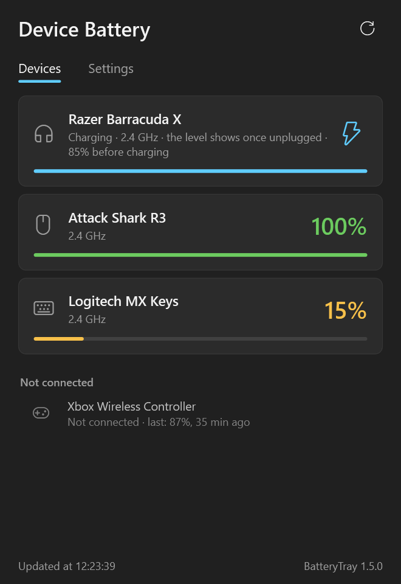

# BatteryTray — wireless headset, mouse, keyboard and gamepad battery level in the Windows tray

[](https://github.com/qu1ncky/BatteryTray/releases/latest)
[](https://github.com/qu1ncky/BatteryTray/releases)
[](LICENSE)


**English** · [Русский](README.ru.md) · [中文](README.zh-CN.md)

See how much battery your wireless headset, mouse, keyboard and controller have left — right next to the clock — and get a reminder **before** they die mid-game or mid-call. One small app for all your devices instead of Razer Synapse, Logitech G HUB, SteelSeries GG, HyperX NGENUITY or Corsair iCUE: no account, no vendor software, it only reads the battery.



## Features

- **Battery level in the tray** — the icon shows the device that will run out first: green, yellow below your reminder level, red below the critical level, blue while charging. Hover it to see every device.
- **All devices in one window** — connected ones as cards with their percentage, the rest with the last known level and when it was seen.
- **Low battery reminder that can't be missed** — its own always-on-top window in the corner, not a toast: Do Not Disturb doesn't hide it, it doesn't time out and it doesn't steal focus from a game. "Remind me in N min" or "Don't remind me until it's charged"; at the critical level it comes back even if snoozed.
- **Charging complete notification** — when a device that can tell finishes charging with the cable still in.
- **No made-up percentages** — when a device can't report its level while charging, you see a charging sign instead of a stale number; estimates are marked with "≈".
- **English, Russian and Chinese** — follows the Windows language, switch any time in Settings.
- **Updates itself** from GitHub releases (SHA-256 checked), quietly, while its windows are closed.
- Starts with Windows, lives in the tray, never changes anything on your devices.

## Supported devices

| Devices | Connection | Status |
|---|---|---|
| **Razer Barracuda X** (2022) | USB-C 2.4 GHz dongle (`1532:0550`) | ✅ tested |
| Razer Barracuda X (2022), dongle `1532:0552` | 2.4 GHz | ⚠️ untested |
| **Attack Shark R3** | 2.4 GHz receiver (`3151:402D`) | ✅ tested |
| Other mice and keyboards on the Rongyuan platform (Attack Shark and others, 81 receiver models) | 2.4 GHz receiver | ⚠️ untested |
| **Razer mice**: Viper Ultimate / V2 Pro / V3 Pro / Mini SE, DeathAdder V2 Pro / V3 Pro / V3 HyperSpeed / V4 Pro, Basilisk Ultimate / V3 Pro / V3 Pro 35K / X HyperSpeed, Naga Pro / V2 Pro, Cobra Pro / HyperSpeed, Pro Click (Mini, V2), Lancehead, Mamba, Orochi V2, Atheris and more — about 40 models | HyperSpeed receiver or cable | ⚠️ untested |
| **Razer keyboards**: BlackWidow V3 Pro / V3 Mini / V4 Mini / V4 TKL HyperSpeed, DeathStalker V2 Pro (and TKL), Joro | receiver or cable | ⚠️ untested |
| **Logitech** mice, keyboards and other HID++ devices: MX Master / Anywhere, MX Keys, G Lightspeed series, M and K series and more | Unifying / Bolt / Lightspeed / Nano receiver or cable | ⚠️ untested |
| **Logitech G headsets**: G533, G535, G633 / G635 / G733 / G933 / G935, G PRO / PRO X Wireless, G930, ASTRO A50 (Gen 5) | receiver | ⚠️ untested |
| **SteelSeries** mice: Aerox 3 / 5 / 9 Wireless, Prime Wireless, Prime Mini Wireless, Rival 3 Wireless (and Gen 2), Rival 650 Wireless | receiver or cable | ⚠️ untested |
| **SteelSeries Arctis** headsets: 1, 7, 9, Pro Wireless, 7+, Nova 3P, Nova 5, Nova 7 (7X, 7P, Gen 2), Nova Pro Wireless, GameBuds | receiver | ⚠️ untested |
| **HyperX** headsets: Cloud Alpha Wireless, Cloud II Wireless, Cloud Flight | receiver | ⚠️ untested |
| **Corsair** headsets: Void series, HS70, Void / Virtuoso / HS80 MAX Wireless, Virtuoso XT / SE | receiver | ⚠️ untested |
| Sony INZONE H5, MCHOSE X9, Lenovo Wireless VoIP | receiver | ⚠️ untested |
| **Sony DualSense**, DualSense Edge, DualShock 4 | cable, Sony adapter; Bluetooth once a game or Steam has switched the controller to full reports | ⚠️ untested |
| **Xbox controllers** via the Xbox Wireless Adapter (XInput) | adapter | ⚠️ untested; XInput only knows 4 levels |
| **Any Bluetooth device** whose battery Windows shows (Xbox controller, many mice, keyboards and headsets) | Bluetooth | ✅ tested (Xbox controller) |
| Any USB device that reports the standard HID "Battery Strength" | receiver or cable | ⚠️ untested |

"Untested" means it follows the protocol as documented by the open source projects listed in [How it works](#how-it-works), but nobody has confirmed it on the real device yet — if you have one, please report how it went in [Issues](https://github.com/qu1ncky/BatteryTray/issues).

Notes on specific devices:

- **Razer Barracuda X** sends its own percentage through the dongle whenever it changes by 1%. Until it has sent one (right after the app starts), the level is estimated from the battery voltage and shown with "≈". While charging there is no percentage at all — the headset's number only creeps towards 100% at a fixed pace — so you see that it's charging, when it's almost full and when it's done.
- **Attack Shark / Rongyuan mice** on their cable leave the receiver and report no level over the cable (the vendor's own driver doesn't show one either), so they show as charging, and the receiver reports the real level once the cable is out.
- **Bluetooth** devices are listed only while connected: Windows keeps a stale percentage after they disconnect.

## Download and install

1. Download `BatteryTray-…-win-x64.zip` from [Releases](https://github.com/qu1ncky/BatteryTray/releases/latest) and unzip it.
2. Run `install.cmd` and confirm the administrator prompt.
3. The icon appears next to the clock. Windows 11 hides new icons behind the **^** arrow — drag it onto the taskbar to keep the number in sight.

It installs to `C:\Program Files\BatteryTray` and starts at sign-in through a Task Scheduler task named "BatteryTray". No .NET installation needed. To remove it, run `uninstall.cmd` from the zip.

**Windows may warn about an unknown app** because the exe isn't code-signed: click "More info" → "Run anyway".

**Portable use:** you can also just run `BatteryTray.exe` from anywhere; start with Windows can be turned on in Settings → System (with normal rights).

## FAQ

**How do I see my Razer Barracuda X battery on PC without Razer Synapse?**
Install BatteryTray: it reads the headset through its USB-C 2.4 GHz dongle, no Bluetooth or Synapse needed.

**How do I check my Logitech mouse or keyboard battery without G HUB or Options+?**
BatteryTray asks the device over Logitech's HID++ protocol through the Unifying, Bolt or Lightspeed receiver.

**Can it show my Bluetooth headphones' battery?**
Yes, if Windows itself knows it (Settings → Bluetooth & devices shows a percentage), BatteryTray shows it in the tray too.

**Why does it ask for administrator rights?**
On some PCs third-party drivers lock a receiver's service channel to administrators — for example the G-SPY driver (`vkbms.inf`) that comes with some cheap keyboards takes every HID collection with usage `FF00:0001`, the Razer dongle included. The installed app therefore starts through a scheduled task with highest privileges (no UAC prompt at each sign-in) and lives in Program Files, where its exe can't be swapped without admin rights. Without that driver, normal rights are enough.

**Why is there no percentage while my device charges?**
Some devices don't report their level on the cable (or report a number that has nothing to do with the real charge). BatteryTray then shows that it's charging rather than a stale or made-up number.

**My device isn't listed.**
Run this in PowerShell while the device is connected and post the output in [Issues](https://github.com/qu1ncky/BatteryTray/issues):

```powershell
Get-PnpDevice -PresentOnly | ? InstanceId -match '^USB\\VID_\w{4}&PID_\w{4}\\' | % { "{0}  {1}" -f $_.InstanceId.Substring(4,17), (Get-PnpDeviceProperty -InstanceId $_.InstanceId -KeyName DEVPKEY_Device_BusReportedDeviceDesc).Data }
```

A diagnostic poll helps too: `"C:\Program Files\BatteryTray\BatteryTray.exe" --dump "%USERPROFILE%\Desktop\battery.txt"`, plus the log in `%LOCALAPPDATA%\BatteryTray\log.txt`.

## Languages

English, Russian and Chinese. The app follows the Windows display language (Russian on a Russian Windows, Chinese on a Chinese one, English otherwise); pick another one any time in Settings → Language — it switches at once, no restart. Translations live in [`Core/Loc.cs`](Core/Loc.cs); corrections and new languages are welcome.

## Updates

Half a minute after start and then every 6 hours the app looks at the latest release of this repository. If it's newer:

- **with automatic updates** (the default) it downloads `BatteryTray.exe` from the release, checks its SHA-256 against the digest GitHub publishes and the version inside the file, swaps its own exe and restarts — only while its windows are closed;
- **without them**, or when writing to Program Files needs admin rights, it tells you once, and the "Update" button installs it (with a UAC prompt in the second case).

Everything is in Settings → Updates: status, what's new, "Check now" and the automatic updates switch.

## How it works

| Source | Protocol |
|---|---|
| `RazerBarracudaProvider` | Airoha RACE commands through the dongle: switch it to remote mode, ask for the voltage (`GET_BATTERY`), back to local mode (ported from [razer-barracuda-x-battery](https://github.com/mehdibouchami/razer-barracuda-x-battery)). Plus the notifications the headset sends by itself (RACE frames of type `0x08`, payload `[id 02 01 value]`): `0x20` headset on/off, `0x21` its own battery percentage, `0x2A` cable in/out — found by listening to the dongle. End of charge: after holding 4.20 V, the voltage drops below 4.18 V with the cable still in. |
| `RongyuanDongleProvider` | Feature report `[00 F7 …]` on interface 2 (vendor page `FFFF`), reply `[00 canRead kbBattery mouseBattery kbOffline mouseOffline …]`, from the official ATTACK SHARK web driver. A mouse on its cable (32 USB IDs from the same driver) takes over the receiver slot that lost it. |
| `SteelSeriesProvider` | Output report `0x92` / `0xD2` (Aerox, Prime) or `AA 01` (Rival) on the service interface, after [rivalcfg](https://github.com/flozz/rivalcfg). |
| `RazerPeripheralProvider` | OpenRazer's 90-byte feature report: command `07 80` (level 0–255), `07 84` (charging), CRC = XOR of bytes 2–87; transaction id and reply delay per model, from OpenRazer's tables. |
| `LogitechProvider` | HID++: ping receiver slots 1–6 (or index `0xFF` for a device on its cable), find the battery feature `0x1004` / `0x1000` / `0x1001` / `0x1F20` and the name `0x0005`; HID++ 1.0 registers `0x0D` / `0x07` for older devices. After [Solaar](https://github.com/pwr-Solaar/Solaar). |
| `HeadsetProvider` | Request and reply on the headset's vendor HID channel, bytes after [HeadsetControl](https://github.com/Sapd/HeadsetControl) (own implementation). Logitech G headsets report a voltage, converted with per-model tables. |
| `StandardHidBatteryProvider` | Reads the Generic Device Controls / Battery Strength field (`06:20`) from the feature reports of any USB HID device. |
| `PlayStationProvider` | Sends nothing: reads one input report and its status byte (DualSense `data[53]` USB / `data[54]` Bluetooth, DualShock 4 `data[30]` / `data[32]`), like Linux's `hid-playstation`. |
| `XInputProvider` | `XInputGetBatteryInformation`: 4 levels → approximate percentage. Skips Bluetooth controllers, whose exact level comes from Windows. |
| `BluetoothProvider` | The `DEVPKEY_Bluetooth_Battery` device property (what Settings → Bluetooth shows), only while `ConnectionStatus = Connected`. |

Files in `%LOCALAPPDATA%\BatteryTray`: `settings.json` (thresholds, names, hidden devices, language), `state.json` (last known levels), `log.txt` (connections, level changes, reminders).

A new device family is one class in `Providers/` implementing `IBatteryProvider`: poll the hardware, say when to poll again.

## Build from source

Needs the [.NET 8 SDK](https://dotnet.microsoft.com/download/dotnet/8.0).

```
dotnet build                        # debug build
install.cmd                         # build and install
powershell -File build-release.ps1  # release exe and zip in dist\
```

### Releasing a version

1. Raise `<Version>` in `BatteryTray.csproj`.
2. `powershell -File build-release.ps1`.
3. `gh release create vX.Y.Z dist\BatteryTray-X.Y.Z-win-x64.zip dist\BatteryTray.exe --title "BatteryTray X.Y.Z" --notes "what's new"`.

The updater takes the asset named exactly `BatteryTray.exe` from the latest release, and the tag must match the version inside the exe. Drafts and pre-releases are ignored by the updater, handy for testing a build.

## License

MIT — see [LICENSE](LICENSE). Third-party code and protocol sources: [THIRD_PARTY_NOTICES.md](THIRD_PARTY_NOTICES.md). Not affiliated with Razer, Logitech, SteelSeries, HyperX, Corsair, Sony, Microsoft or ATTACK SHARK; product names are trademarks of their owners.
