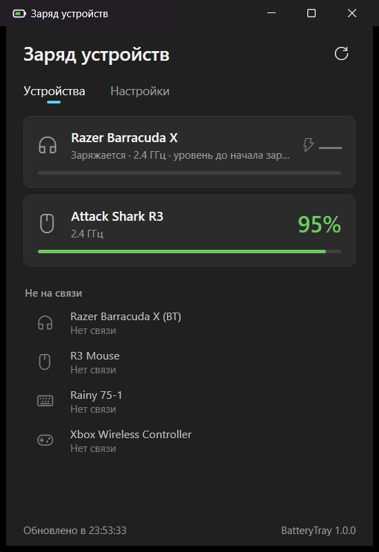

# BatteryTray

Заряд беспроводных наушников, мышей, клавиатур и геймпадов в трее Windows — и напоминание, которое не даст им сесть внезапно.

*English: a Windows tray app that shows the battery level of wireless headsets, mice, keyboards and gamepads (Razer Barracuda X via its dongle, Attack Shark / Rongyuan 2.4 GHz mice, SteelSeries mice, any Bluetooth device Windows knows the battery of) and pops up a reminder that stays until you act. Download the zip from Releases and run `install.cmd`.*



## Что умеет

- **Значок в трее** — цифра заряда устройства, которое сядет первым. Зелёная; жёлтая ниже порога напоминания; красная ниже критического; синяя при зарядке. Наведите курсор — увидите все устройства.
- **Окно со всеми устройствами** — клик по значку. Подключённые — карточками с процентом, выключенные — списком с последним известным зарядом и временем.
- **Напоминание о разряде** — своё окно поверх всех окон в углу экрана, а не системное уведомление: его не глушит «Не беспокоить», оно не пропадает само и не забирает фокус у игры. Кнопки «Напомнить через N мин» и «Не напоминать до зарядки». На критическом уровне появится ещё раз, даже если его отложили.
- **Настройки** — порог напоминания, критический уровень, интервал повтора, звук; для каждого устройства — своё название, скрыть, отключить напоминания.
- Запускается при входе в Windows, есть ярлык в «Пуске». Ничего не меняет в устройствах: только читает статус.

## Какие устройства поддерживаются

| Устройство | Подключение | Статус |
|---|---|---|
| Razer Barracuda X (2022) | USB-C донгл 2.4 ГГц (`1532:0550`) | ✅ проверено |
| Razer Barracuda X (2022), вариант донгла `1532:0552` | 2.4 ГГц | ⚠️ не проверено |
| Attack Shark R3 | приёмник 2.4 ГГц (`3151:402D`) | ✅ проверено |
| Другие мыши и клавиатуры на платформе Rongyuan (Attack Shark и др., 81 модель приёмника) | приёмник 2.4 ГГц | ⚠️ не проверено |
| SteelSeries Aerox 3 / 5 / 9 Wireless, Prime Wireless, Prime Mini Wireless, Rival 3 Wireless (и Gen 2), Rival 650 Wireless | приёмник 2.4 ГГц или кабель | ⚠️ не проверено |
| Любое Bluetooth-устройство, заряд которого показывает сама Windows (геймпад Xbox, многие мыши, клавиатуры, гарнитуры) | Bluetooth | ✅ проверено (геймпад Xbox) |

Bluetooth-устройства показываются, только пока подключены: после отключения Windows хранит устаревший процент.

Процент у Razer Barracuda X — оценка по напряжению батареи, шагами по 5%: другого наушники через донгл не сообщают. Во время зарядки напряжение завышено, поэтому показывается уровень до зарядки.

## Установка

1. Скачайте `BatteryTray-…-win-x64.zip` со страницы [Releases](https://github.com/qu1ncky/BatteryTray/releases/latest) и распакуйте.
2. Запустите `install.cmd` и подтвердите запрос администратора.
3. Значок появится у часов. Windows 11 прячет новые значки под стрелку **^** — перетащите его на панель задач, чтобы цифра была видна всегда.

Программа ставится в `C:\Program Files\BatteryTray` и запускается при входе в Windows задачей Планировщика «BatteryTray». .NET устанавливать не нужно.

Обновление — так же: скачать новый релиз и запустить `install.cmd`. Удаление — `uninstall.cmd` из того же архива.

**Windows может предупредить**, что приложение неизвестное: exe не подписан сертификатом. Нажмите «Подробнее» → «Выполнить в любом случае».

**Без установки.** Можно просто запустить `BatteryTray.exe` откуда угодно: всё работает, а автозапуск включается в «Настройки → Система» (с обычными правами).

### Зачем права администратора

На некоторых компьютерах сторонние драйверы закрывают доступ к служебному каналу USB-приёмника. Например, драйвер G-SPY (`vkbms.inf`) от некоторых дешёвых клавиатур забирает себе все HID-устройства с usage `FF00:0001` — среди них донгл Razer — и открывает их только администраторам. Тогда у устройства написано «нужны права администратора». Поэтому установленная программа запускается задачей с наивысшими правами (без окна UAC при каждом входе), а лежит в Program Files, где её exe не подменить без прав администратора.

## Моего устройства нет

Выполните в PowerShell, пока устройство подключено, и пришлите результат в [Issues](https://github.com/qu1ncky/BatteryTray/issues):

```powershell
Get-PnpDevice -PresentOnly | ? InstanceId -match '^USB\\VID_\w{4}&PID_\w{4}\\' | % { "{0}  {1}" -f $_.InstanceId.Substring(4,17), (Get-PnpDeviceProperty -InstanceId $_.InstanceId -KeyName DEVPKEY_Device_BusReportedDeviceDesc).Data }
```

Пригодится и диагностика: `"C:\Program Files\BatteryTray\BatteryTray.exe" --dump "%USERPROFILE%\Desktop\battery.txt"` — один опрос всех источников в файл, и лог `%LOCALAPPDATA%\BatteryTray\log.txt`.

Новое устройство добавляется отдельным классом в `Providers/` (интерфейс `IBatteryProvider`: опросить устройство и сказать, когда опрашивать снова).

## Как это работает

| Источник | Протокол |
|---|---|
| `RazerBarracudaProvider` | Команды Airoha RACE через донгл: перевести донгл в remote-режим, запросить напряжение (`GET_BATTERY`), вернуть local-режим. Напряжение → процент по кривой Li-ion; зарядка определяется по разбросу напряжения между замерами. Порт из [razer-barracuda-x-battery](https://github.com/mehdibouchami/razer-barracuda-x-battery). |
| `RongyuanDongleProvider` | Feature-отчёт `[00 F7 …]` на интерфейсе 2 (vendor page `FFFF`), ответ `[00 canRead kbBattery mouseBattery kbOffline mouseOffline …]`. Найден в официальном веб-драйвере ATTACK SHARK, который шлёт эту команду каждые 5 секунд. |
| `SteelSeriesProvider` | Output-отчёт `0x92` / `0xD2` (Aerox, Prime) или `AA 01` (Rival) на служебном интерфейсе, по [rivalcfg](https://github.com/flozz/rivalcfg). |
| `BluetoothProvider` | Свойство устройства `DEVPKEY_Bluetooth_Battery` (то, что показывает «Параметры → Bluetooth»), только при `ConnectionStatus = Connected`. |

Файлы: `%LOCALAPPDATA%\BatteryTray` — `settings.json` (пороги, названия, скрытые устройства), `state.json` (последний известный заряд), `log.txt` (подключения, изменения заряда, напоминания).

## Сборка из исходников

Нужен [.NET 8 SDK](https://dotnet.microsoft.com/download/dotnet/8.0).

```
dotnet build                      # отладочная сборка
install.cmd                       # собрать и установить
powershell -File build-release.ps1  # exe и zip для релиза в dist\
```

## Лицензия

MIT — см. [LICENSE](LICENSE). Чужой код и источники протоколов — в [THIRD_PARTY_NOTICES.md](THIRD_PARTY_NOTICES.md). Проект не связан с Razer, SteelSeries, ATTACK SHARK и Microsoft; названия — товарные знаки их владельцев.
