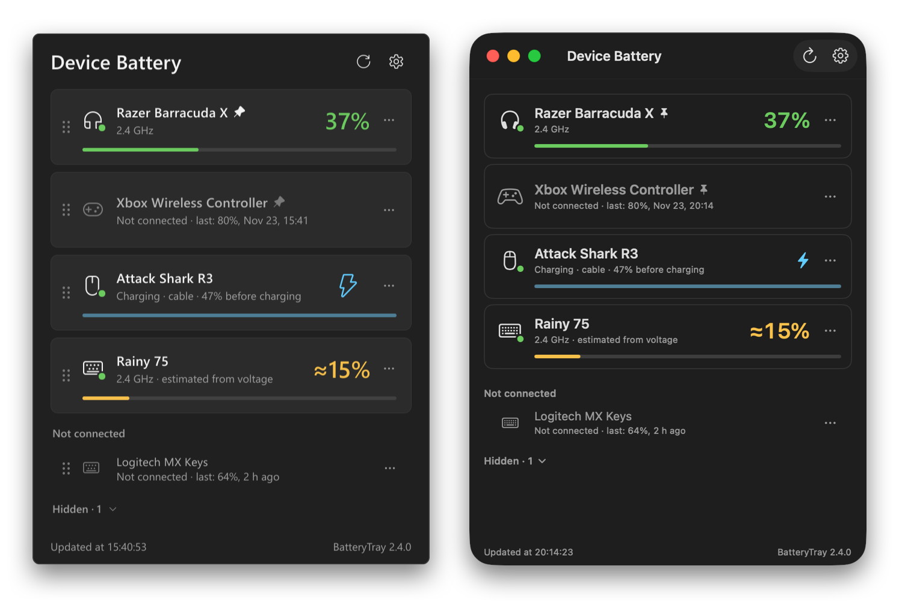
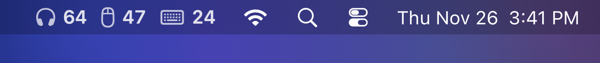
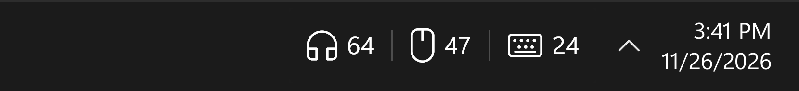
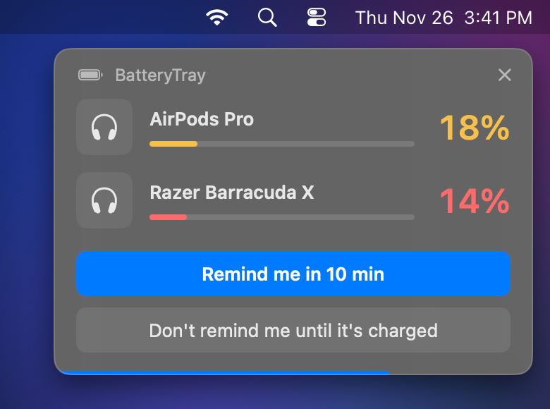
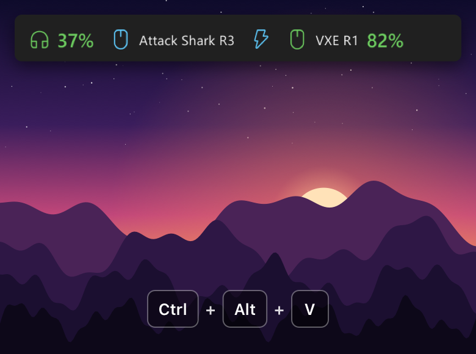
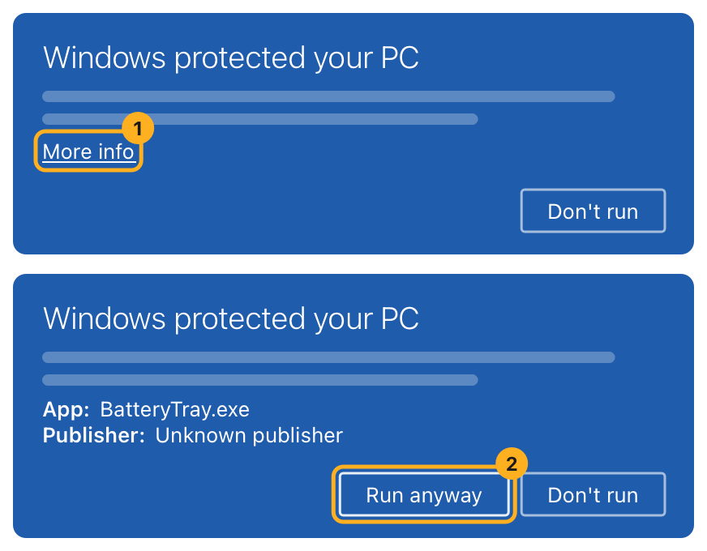
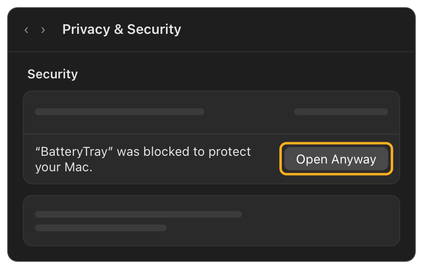

# BatteryTray

**The battery level of your wireless headset, mouse, keyboard and controller — on the Windows taskbar and in the Mac menu bar.**

**English** · [Русский](README.ru.md) · [中文](README.zh-CN.md)

&nbsp;&nbsp;

Free and open source · no account, no vendor software · <a href="#download-and-install">how to install</a> · <a href="https://github.com/qu1ncky/BatteryTray/releases">release notes</a>

- **One app for all your devices.** Gaming mice, keyboards and headsets from Razer, Logitech, SteelSeries, HyperX, Corsair, ASUS ROG and dozens of other brands through their 2.4 GHz receivers, plus Xbox and DualSense controllers, AirPods and any Bluetooth device whose level the system knows. [Supported devices](docs/en/devices.md)
- **Always in sight.** Next to the clock on Windows and in the Mac menu bar, in a warning color when a device runs low.
- **A reminder you won't miss**, before a battery dies mid-game or mid-call. Do Not Disturb doesn't hide it.
- **Over games:** turn on the overlay in Settings → Overlay, and <kbd>Ctrl</kbd>+<kbd>Alt</kbd>+<kbd>V</kbd> (<kbd>⌃⌥V</kbd> on a Mac) shows every device's level for five seconds. [All features](docs/en/features.md)

   
  The Mac menu bar

   
  The Windows taskbar (Settings → General → Taskbar)

<table>
<tr>
<td width="50%"></td>
<td width="50%"></td>
</tr>
<tr>
<td align="center">The reminder: snooze it, mute it until the device is charged, or let it close by itself</td>
<td align="center">The overlay, over games and full-screen apps</td>
</tr>
</table>

## Download and install

<table>
<tr>
<td width="50%" valign="top">

**Windows 10 and 11**

1. Download [`BatteryTray.exe`](https://github.com/qu1ncky/BatteryTray/releases/latest/download/BatteryTray.exe) and run it.
2. If Windows warns about an unknown app: **More info** → **Run anyway**.
3. The level appears next to the clock (Windows 11 may put it under **^**: drag it out). **Enable** above the device list starts it with Windows.

Or `winget install qu1ncky.BatteryTray`, or [Scoop](https://scoop.sh): `scoop bucket add batterytray https://github.com/qu1ncky/BatteryTray`, then `scoop install batterytray`.

</td>
<td width="50%" valign="top">

**macOS 13 or later**, Apple Silicon and Intel

1. Open [`BatteryTray-macOS.dmg`](https://github.com/qu1ncky/BatteryTray/releases/latest/download/BatteryTray-macOS.dmg) and drag **BatteryTray** to **Applications**.
2. Open it. The first time macOS blocks it: **System Settings → Privacy & Security → Open Anyway**.
3. Click **Allow** for Bluetooth. The levels appear in the menu bar. **Enable** above the device list opens it at login.

Permissions: Bluetooth, and Input Monitoring only when a keyboard is connected (macOS asks it of every app that opens one; BatteryTray reads only its battery). Nothing else.

</td>
</tr>
</table>

## More

[Supported devices](docs/en/devices.md) · [All features](docs/en/features.md) · [FAQ](docs/en/faq.md) · [How it works](docs/en/how-it-works.md) · [Build from source](docs/development.md) · [Release notes](https://github.com/qu1ncky/BatteryTray/releases)

A device is missing or something is wrong? [Open an issue](https://github.com/qu1ncky/BatteryTray/issues) and attach the log: `%LOCALAPPDATA%\BatteryTray\log.txt` on Windows, `~/Library/Application Support/BatteryTray/log.txt` on a Mac. To get a new device added, also attach what [this command](docs/en/devices.md#device-not-listed) prints while it is connected: its receiver's USB IDs.

## License

[MIT](LICENSE). Third-party code, protocol sources and the Slint attribution: [THIRD_PARTY_NOTICES.md](THIRD_PARTY_NOTICES.md). Not affiliated with Apple, Razer, Logitech, SteelSeries, HyperX, Corsair, ASUS, Sony, Microsoft, Valve, ATTACK SHARK or any other maker named here; product names are trademarks of their owners.
