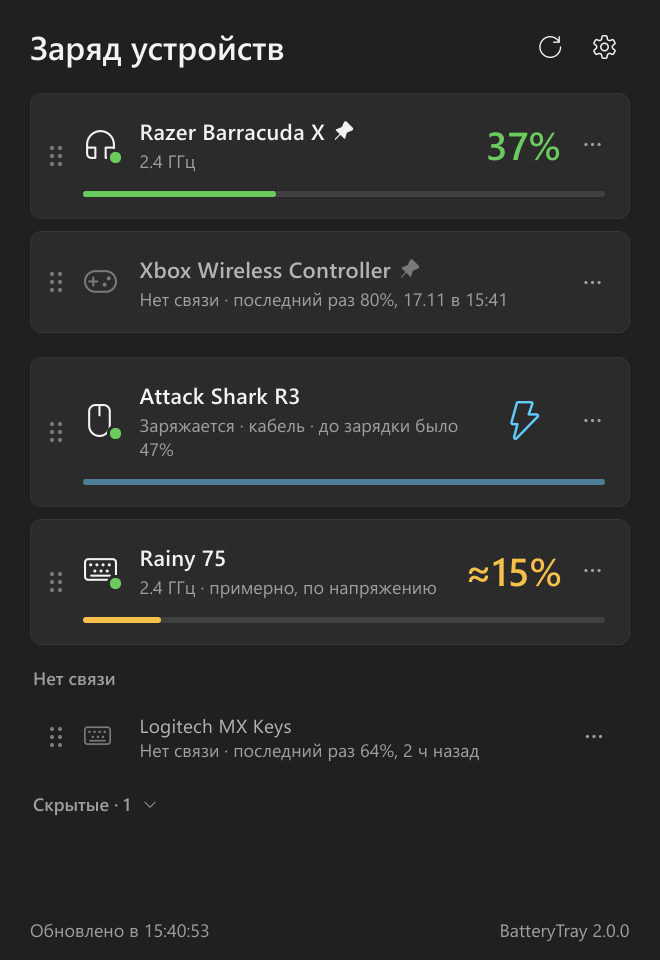

# BatteryTray — заряд беспроводных наушников, мышей, клавиатур и геймпадов в трее Windows

[English](README.md) · **Русский** · [中文](README.zh-CN.md)

Сколько осталось заряда у беспроводных наушников, мыши, клавиатуры и геймпада — прямо у часов, и напоминание, которое не даст им сесть внезапно. Одна небольшая программа для всех устройств вместо Razer Synapse, Logitech G HUB, SteelSeries GG и прочих: без аккаунта и фирменного софта, она только читает заряд.



## Что умеет

- **Значок в трее** — цифра заряда устройства, которое пора заряжать первым. Зелёная; жёлтая ниже его порога напоминания; красная ниже его критического; синяя при зарядке. Наведите курсор — увидите все устройства.
- **Окно со всеми устройствами** — клик по значку. Подключённые — карточками с процентом, выключенные — списком «Нет связи» с последним известным зарядом и временем. В меню **⋯** устройства его можно переименовать, закрепить вверху списка или скрыть в «Скрытые»; порядок меняется перетаскиванием карточки за ручку слева (ему следуют оверлей и подсказка значка).
- **Оверлей** — включите горячую клавишу в разделе **«Настройки (шестерёнка) → Оверлей»**, затем нажмите **Ctrl+Alt+V**, чтобы на пять секунд увидеть подключённые, нескрытые устройства на экране активного приложения. Повторное нажатие начинает отсчёт заново. В режиме переключения то же сочетание показывает и скрывает окно. Можно выбрать другое сочетание и угол экрана, а также открыть предпросмотр при выключенной горячей клавише. Названия устройств одного типа видны автоматически, при желании можно показывать все названия. Работает на рабочем столе и в играх без рамки, не забирая фокус и не перехватывая мышь.
- **Напоминание о разряде** — своё окно поверх всех окон в углу экрана, а не системное уведомление: его не глушит «Не беспокоить», оно не пропадает само и не забирает фокус у игры. Кнопки «Напомнить через N мин» и «Не напоминать до зарядки». На критическом уровне появится ещё раз, даже если его отложили.
- **Зарядка завершена** — обычное уведомление Windows, когда устройство, которое умеет это сообщать, зарядилось, а кабель ещё подключён. Одно на зарядку: подзарядки полной батареи его не повторяют.
- **Без выдуманных процентов** — если устройство во время зарядки свой заряд не сообщает, вместо числа показывается ⚡ и пульсирующая полоса, а не старый процент. Оценка (а не число от самого устройства) помечается знаком «≈».
- **Русский, английский и китайский** — язык как в Windows, переключается в «Настройки → Общие» в любой момент, без перезапуска.
- **Настройки** — порог напоминания, критический уровень, интервал повтора, звук («Настройки → Напоминания»); для каждого устройства в его меню **⋯** — своё название, закрепить, скрыть, отключить напоминания или задать свой порог напоминания и критический уровень (например, о наушниках напоминать при 40%, а о мыши — при 15%).
- **Обновляется сама** с GitHub: новая версия ставится тихо, пока окна программы закрыты, а потом всплывает «BatteryTray обновлён».
- **Лёгкая** — один exe примерно на 10 МБ, в трее занимает около 8 МБ памяти; больше ничего ставить не нужно.
- Запускается при входе в Windows, есть ярлык в «Пуске». Ничего не меняет в устройствах: только читает статус.

## Какие устройства поддерживаются

| Устройство | Подключение | Статус |
|---|---|---|
| Razer Barracuda X (2022) | USB-C донгл 2.4 ГГц (`1532:0550`) | ✅ проверено |
| Razer Barracuda X (2022), вариант донгла `1532:0552` | 2.4 ГГц | ⚠️ не проверено |
| Гарнитуры Razer: BlackShark V2 HyperSpeed, BlackShark V2 Pro (2020 и 2023), BlackShark V3, BlackShark V3 X HyperSpeed, Kraken V4 / V4 Pro, Kraken Kitty V3 Pro, Barracuda Pro | приёмник или кабель | ⚠️ не проверено |
| Мыши Razer: Viper Ultimate / V2 Pro / V3 Pro / V4 Pro / Mini SE, DeathAdder V2 Pro / V3 Pro / V3 HyperSpeed / V4 Pro, Basilisk Ultimate / V3 Pro / V3 Pro 35K / V4 Pro / V4 HyperSpeed / X HyperSpeed, Naga Pro / V2 Pro / V3 Pro, Cobra Pro / HyperSpeed, Pro Click (и Mini, V2), Lancehead, Mamba, Orochi V2, Atheris и другие — около 45 моделей | приёмник HyperSpeed или кабель | ⚠️ не проверено |
| Клавиатуры Razer: BlackWidow V3 Pro / V3 Mini / V4 Mini / V4 TKL HyperSpeed, BlackWidow V4 Low-Profile (и TKL) HyperSpeed, DeathStalker V2 Pro (и TKL), Pro Type Ultra / Ergo, Joro | приёмник или кабель | ⚠️ не проверено |
| Мыши, клавиатуры и другие устройства Logitech с протоколом HID++ (MX Master / Anywhere, MX Keys, серия G Lightspeed, M- и K-серии и др.) | приёмник Unifying / Bolt / Lightspeed / Nano или кабель | ⚠️ не проверено |
| Гарнитуры Logitech G: G533, G535, G633 / G635 / G733 / G933 / G935, G PRO / PRO X Wireless, G PRO X 2 LIGHTSPEED, G PRO X 3 LIGHTSPEED, G522 LIGHTSPEED, G930 | приёмник | ⚠️ не проверено |
| Гарнитуры ASTRO: A50 (Gen 4, Gen 5), A50 X, A20 X | базовая станция, передатчик или кабель | ⚠️ не проверено |
| SteelSeries Aerox 3 / 5 / 9 Wireless, Aerox 3 Wireless Gen 2, Prime Wireless, Prime Mini Wireless, Rival 3 Wireless (и Gen 2), Rival 650 Wireless | приёмник 2.4 ГГц или кабель | ⚠️ не проверено |
| Гарнитура SteelSeries Arctis Nova 5 | приёмник (`1038:2232`) | ✅ проверено пользователем |
| Гарнитуры SteelSeries Arctis: 1, 7, 9, Pro Wireless, 7+, Nova 3P, Nova 7 (и 7X, 7P, Gen 2), Nova Pro Wireless, Nova Pro Omni, Nova Elite, GameBuds | приёмник или базовая станция | ⚠️ не проверено |
| Гарнитура HyperX Cloud III Wireless | приёмник | ✅ проверено пользователем |
| Гарнитуры HyperX: Cloud Alpha Wireless, Cloud Alpha 2 Wireless, Cloud II Wireless, Cloud II Core Wireless, Cloud III S Wireless, Cloud Flight, Cloud Flight S, Cloud Stinger 2 Wireless, Cloud Stinger Core Wireless (приёмники для PlayStation и DTS) | приёмник | ⚠️ не проверено |
| Мыши HyperX: Pulsefire Haste 2 Wireless / Core / Mini, Pulsefire Haste Wireless, Pulsefire Dart | приёмник или кабель | ⚠️ не проверено |
| Гарнитура Corsair HS80 RGB Wireless | приёмник | ✅ проверено пользователем |
| Гарнитуры Corsair: Void (вся серия), HS70, Void v2 / Virtuoso MAX / HS80 MAX Wireless, Virtuoso, Virtuoso XT / SE | приёмник или кабель | ⚠️ не проверено |
| Мыши и клавиатуры Corsair на приёмнике SLIPSTREAM или своём: Dark Core RGB Pro / Pro SE, Scimitar Elite Wireless, Ironclaw, Harpoon, Sabre RGB Pro, M65 Ultra, M75 / M75 Air, M55, Nightsabre, Darkstar, Katar Pro Wireless; K57, K65 Plus, K70 Core TKL, K70 Pro Mini, K100 Air, MAKR 75 | приёмник или кабель | ⚠️ не проверено |
| Corsair Sabre v2 Pro Wireless (Ultralight, MG, CF) | приёмник или кабель | ⚠️ не проверено |
| Мыши ASUS ROG: Chakram / Chakram X, Gladius II / III Wireless (и AimPoint), Harpe Ace (Aim Lab, Extreme, Mini), Harpe II Ace, Keris Wireless (и AimPoint), Keris II Ace / Origin, Pugio II, Spatha X, Strix Impact II / III Wireless, Strix Carry; TUF Gaming M4 Wireless, TX Gaming Mini и др. | свой приёмник, ROG Omni Receiver, приёмник SpeedNova 8K или кабель | ⚠️ не проверено; старые модели сообщают заряд шагами по 25% |
| Клавиатуры ASUS ROG: Azoth, Azoth Extreme, Azoth X, Falchion, Falchion RX Low Profile, Strix Scope II 96 Wireless, Strix Morph 96 Wireless | свой приёмник, ROG Omni Receiver или кабель | ⚠️ не проверено |
| Гарнитуры ASUS ROG: Pelta, Delta II, Cetra True Wireless SpeedNova, Cetra Open Wireless, Strix Go 2.4 | донгл 2.4 ГГц | ⚠️ не проверено |
| Attack Shark R3 | приёмник 2.4 ГГц (`3151:402D`) | ✅ проверено |
| Мышь AJAZZ AJ179 Pro | приёмник 2.4 ГГц (`3151:402D`, те же ID, что у R3) | ✅ проверено пользователем |
| Другие мыши и клавиатуры на платформе Rongyuan (Attack Shark, Akko, MonsGeek и др., 88 моделей приёмника) | приёмник 2.4 ГГц | ⚠️ не проверено |
| Клавиатура Attack Shark X82 PRO HE | приёмник 2.4 ГГц (`3151:5026`) | ✅ проверено пользователем; на зарядке заряд завышен (см. ниже) |
| Мышь Attack Shark V3 Pro | приёмник 2.4 ГГц (`1D57:FA60`), зарядная станция | ✅ проверено пользователем |
| Другие мыши на приёмниках Xenta: Attack Shark X11, X11 SE, X11 Pro, X3, X3 Max, X3 Pro, X1, X6 / R1, V3, V6, X8 Pro, X8 SE, X8 Plus, G3 Pro, FURYCUBE F1, F1 Pro, F3, G3, G9, G9 PRO, G11, G13S, Delux M600 Pro / M900 Pro / M900 Mini, Inphic IN6 / IN6 SE, IN9 / IN9 Ultra / In9 Pro, IN10 / IN10 MAX, INX, MAMBASNAKE M3 | приёмник 2.4 ГГц (`1D57:FA60`, `1D57:FA65`) или кабель | ⚠️ не проверено |
| Мыши VXE / VGN: R1 PRO / PRO MAX, R1 SE / SE+, Dragonfly R1, Dragonfly F2 | приёмник 2.4 ГГц или кабель | ⚠️ не проверено |
| Мышь ATK A9 Ultra Max 2.0 | приёмник 2.4 ГГц (`373B:11FE`) | ⚠️ не проверено |
| Другие мыши ATK: всё, что работает на её приёмниках 1K, 8K и NearLink (серии X1, A9, F1, U2 и др.), ATK ZERO, VXE R1 NK | приёмник 2.4 ГГц; X1 Pro Max, A9 Plus, A9 Ultimate, A9 Mini+, F1 Ultimate 2.0 — и на кабеле | ⚠️ не проверено |
| Мыши с протоколом CompX: Lamzu Atlantis / Thorn, Scyrox V8 / V8S / V6, Pulsar X2 V2 и донгл CrazyLight 8K, G-Wolves HTX Ultra и её приёмник 8K, Kysona M600, Hitscan Hyperlight, Cougar Revenger Pro, Dareu A950 Wing / EM901X, HECATE G5M PRO, CHERRY XTRFY, GravaStar, Redragon M916 Pro / M991, Endgame Gear XM2we / OP1we | приёмник 2.4 ГГц или кабель | ⚠️ не проверено |
| Мыши на приёмниках Areson `25A7:FA7C` (Redragon M693, Fantech Helios Go XD5 и другие под своими названиями) и `25A7:FA07` / `FA08` (Redragon M915RGB-WL, M913) | приёмник 2.4 ГГц или кабель | ⚠️ не проверено; FA07 / FA08 сообщают заряд шагами по 10% |
| Мышь Ardor Renegade | приёмник 2.4 ГГц (`25A7:FA4A`) | ✅ заряд проверен пользователем; мышь сообщает его с шагом 10% |
| Мыши на приёмнике `A8A5:2255`: AJAZZ AJ139 V2 MC, K-Snake X11, Noir M2-NEX, MCHOSE G7 Pro; MCHOSE G3 V2 (`3837:4245`) | приёмник 2.4 ГГц или кабель | ⚠️ не проверено |
| Мыши Glorious: Model O / O- / D / D- Wireless, Model O PRO, Series One PRO, Model O 2 PRO / D 2 PRO (и версии 4K/8KHz), Series 2 PRO | приёмник 2.4 ГГц или кабель | ⚠️ не проверено |
| Мыши LAMZU поколения Aurora: Maya X, Maya, Inca, Tachi, Paro, Thorn, Atlantis OG Champion, Atlantis Mini, Orcus и др. | приёмник 2.4 ГГц (1K, 8K) или кабель | ⚠️ не проверено |
| WLmouse Beast X (Pro, Mini, Max, V2), Beast G, Beast Miao, Huan, Strider, Ying, Sword X; G-Wolves серий Fenrir, HTX, HTS, HSK, HTR, HT-S2; Arbiter Studio Akitsu; Attack Shark R5 Ultra / R6 / R8; CRDRAKO KO-ONE; LunaFury LUNA33 / TYPE33 | приёмник 2.4 ГГц или кабель | ⚠️ не проверено |
| Мыши MCHOSE: A5 Pro / Pro Max, L7, M7, A7, K7 и их версии V2 / V3 / Pro / Ultra, A5 V2 / V3, K5, R7 Ultra, V7, G3 V3 | приёмник 2.4 ГГц или кабель | ⚠️ не проверено |
| Мыши Keychron: M1 – M7 на приёмнике Link, мыши 4K на 4K Link, мыши 8K (M5 8K, M6 8K и др.) на Ultra-Link 8K, Nape Pro | приёмник 2.4 ГГц или кабель | ⚠️ не проверено |
| Pulsar X2 V3, X2 V3 eS, а также Xlite V4 / X3 на тех же донглах | донгл 2.4 ГГц или кабель | ⚠️ не проверено |
| Мыши VAXEE / ZYGEN (XE, XE-S, XE V2, AX, E1, NP-01, NP-01S), Ninjutso Sora V2 и Ten / Ten Air, Sprime PM1, Endgame Gear OP1w 4k / XM2w 4k, Cooler Master MM712 / MM731, ZOWIE EC1-CW / EC2-CW / EC3-CW, ROCCAT Kone Pro Air, Finalmouse UltralightX | приёмник 2.4 ГГц или кабель | ⚠️ не проверено; VAXEE сообщает заряд шагами по 5%, у Finalmouse заряд — оценка по напряжению |
| Игровые мыши Rapoo VT (линейки VT0 – VT9, около 70 моделей), мыши Incott на приёмнике 8K (G23, G23 V2, G24, Ghero, Zero 29 / 39) | приёмник 2.4 ГГц или кабель | ⚠️ не проверено; мышь Incott появляется, когда её подвигают |
| Machenike L7, Darmoshark M3 / M3S / M3S Pro, MSI VERSA 300 ELITE WIRELESS и CLUTCH GM31 LIGHTWEIGHT WIRELESS, AJAZZ AJ179, AULA SC580 и X9 Ultra / V9 Max+, Akko V9 Dash Pro / Dash V9 Ultra, Delux M800 Pro, DAREU A980 Pro, Royal Kludge MG6 Pro, Niceboy MW400, мыши на приёмнике Sinowealth `258A:002F` (Redragon M602-KS и др.) | приёмник 2.4 ГГц или кабель | ⚠️ не проверено |
| Клавиатуры на приёмниках CompX «BY»: MCHOSE (K99 V2, G75 Pro, X75, G87, K87 и др.), AULA (F75, F75 Max, F87 Pro, F99), VGN (V98 Pro V3, V87 V2, N75 V2, V108), Redragon Horus Pro | приёмник 2.4 ГГц (`3554:FA09`, `3554:FB40`, `41E4:2001`, `258A:024F` и др.) | ⚠️ не проверено |
| Клавиатуры на донглах SONiX: Attack Shark X85, EWEADN X87, AJAZZ AK820 Pro / MAX / Max Plus, EPOMAKER EA75, AULA F87 Pro V2 / F99 MAX / F108 Pro и др. | приёмник 2.4 ГГц (`0C45:FEFE`, `0C45:FDFD`, `0C45:FEFC`, `05AC:024F`) | ⚠️ не проверено; значка зарядки нет |
| CHERRY MX 3.0S Wireless, MX 2.0S Wireless / WL Pro, PIXIU 75; ATK V75X, Z87; VGN / VXE S99, V98 Pro, N75 Pro, VXE75, V87 на приёмнике `320F:5088`; AJAZZ AK992; Attack Shark X98; URX Core75; MCHOSE K87 V3; Alienware Pro Wireless Gaming Keyboard | приёмник 2.4 ГГц или кабель | ⚠️ не проверено |
| Audeze Maxwell / Maxwell 2, AKG N9 Hybrid, Skullcandy PLYR / Crusher PLYR 720, Alienware AW920H, EPOS H3PRO Hybrid, Fractal Design Scape, MOONDROP GM01 Pro | донгл или кабель | ⚠️ не проверено |
| JBL Quantum 350 / 360 / 520 / 610 / 650 / 810 / 850 / 910 / 950 Wireless | донгл или кабель | ⚠️ не проверено |
| Гарнитуры Jabra на адаптере Link 380 / 390, Evolve2 65 Flex и Evolve3 75 на кабеле; гарнитуры Poly Voyager UC на адаптере BT600 | USB-адаптер или кабель | ⚠️ не проверено |
| Sony INZONE H5, INZONE H9 II, INZONE Buds, PULSE 3D; MCHOSE X9, V9 Pro, V9 Pro 2; FIFINE HT6; VGN OMNISOUND; Lenovo Wireless VoIP | приёмник | ⚠️ не проверено |
| Sony DualSense, DualSense Edge, DualShock 4 | кабель, адаптер Sony; Bluetooth — если игра или Steam включили полный режим геймпада | ⚠️ не проверено |
| Steam Controller (2026) на своём приёмнике Puck, Steam Controller (2015) на беспроводном адаптере | приёмник | ⚠️ не проверено |
| 8BitDo Ultimate 2 Wireless, Flydigi Vader 5 Pro / Apex 5 / Apex 6, GameSir Nova 2 / Nova 2 Lite / Super Nova / Tarantula Pro, BEITONG KP40D | приёмник 2.4 ГГц | ⚠️ не проверено; Flydigi сообщает заряд шагами |
| NVIDIA SHIELD Controller (2017) | кабель | ⚠️ не проверено |
| Геймпады Xbox через адаптер Xbox Wireless (XInput) | адаптер | ⚠️ не проверено; XInput знает только 4 уровня заряда |
| Любое Bluetooth-устройство, заряд которого показывает сама Windows (геймпад Xbox, многие мыши, клавиатуры, гарнитуры) | Bluetooth | ✅ проверено (геймпад Xbox) |
| Любое USB-устройство, которое сообщает заряд стандартным полем HID «Battery Strength» | приёмник или кабель | ⚠️ не проверено |

Bluetooth-устройства показываются, только пока подключены: после отключения Windows хранит устаревший процент.

Приёмники, общие для нескольких брендов. У многих недорогих приёмников 2.4 ГГц одни и те же USB ID стоят на совсем разных устройствах. Устройство с такими ID появляется в списке после первого ответа, чтобы ни у кого не висела «спящая» клавиатура, которой у него нет; до тех пор программа обращается к нему всё реже. Если ваше устройство есть в таблице, но не появилось, разбудите его и подождите минуту; если не помогло, пришлите `log.txt` в [Issues](https://github.com/qu1ncky/BatteryTray/issues).

Клавиатуры опрашиваются не чаще раза в 5 минут (некоторые — раз в 35): запрос может не дать клавиатуре уснуть.

Razer BlackShark V3 опрашивается раз в пять минут: при более частых запросах гарнитура теряет связь 2.4 ГГц. Поэтому её заряд может быть на несколько минут старше.

ASUS ROG Omni Receiver: мышь и клавиатура на одном приёмнике показываются отдельно. У базовой станции ASTRO A50 переключатель должен стоять на PC, и пока открыт ASTRO Command Center, прочитать её нельзя. Sony PULSE 3D и мыши Incott сообщают о себе только при изменениях, поэтому появляются чуть позже включения.

Razer Barracuda X сама присылает через донгл свой процент (при каждом изменении на 1%) и состояние кабеля — программа их слушает. Сразу после запуска программы, пока числа от наушников ещё не было, показывается оценка по напряжению батареи со знаком «≈». Во время зарядки процента нет: число наушников — сглаженное напряжение, и на кабеле оно просто ползёт к 100% по 1% за 20 секунд, хотя последняя четверть заряжается больше часа. Вместо него видно, что идёт зарядка, её последний этап (зарядка держит ровно 4,20 В) и момент, когда она закончилась. Пару минут после отключения кабеля процент тоже не показывается, пока число наушников оседает.

Мышь Rongyuan / Attack Shark на кабеле уходит из приёмника и по проводу заряд не сообщает (официальный веб-драйвер его тоже не показывает). Поэтому она показывается как «заряжается · кабель» без процента, а настоящий процент приёмник отдаст, когда кабель отключат.

Клавиатура Attack Shark X82 PRO HE на зарядке по кабелю остаётся на приёмнике, но сообщает заряд на 20–30% выше настоящего, а после отключения кабеля — снова настоящий. Скорее всего, клавиатура считает заряд по напряжению батареи, а зарядка его поднимает. Узнать, что клавиатура на кабеле, неоткуда: ответ приёмника не меняется, нового USB-устройства не появляется, а официальный веб-драйвер показывает то же завышенное число. Поэтому число показывается как есть ([#5](https://github.com/qu1ncky/BatteryTray/issues/5)).

Мыши на приёмнике Xenta (`1D57:FA60`: Attack Shark, FURYCUBE, Delux, Inphic, MAMBASNAKE) сами присылают свой заряд каждые 2 секунды: программа их только слушает и ничего им не отправляет. На кабеле или на зарядной станции число от мыши замирает, поэтому вместо него видна зарядка, а настоящий процент появляется через несколько секунд после того, как мышь сняли с зарядки. Модель мышь сообщает кодом в этих сообщениях. Мышь с ещё незнакомым кодом видна без процента, а её сообщения пишутся в лог: пришлите строки `Xenta` из `%LOCALAPPDATA%\BatteryTray\log.txt` в [Issues](https://github.com/qu1ncky/BatteryTray/issues), и модель добавится.

## Установка

1. Скачайте `BatteryTray-…-win-x64.zip` со страницы [Releases](https://github.com/qu1ncky/BatteryTray/releases/latest) и распакуйте.
2. Запустите `install.cmd` и подтвердите запрос администратора.
3. Значок появится у часов. Windows 11 прячет новые значки под стрелку **^** — перетащите его на панель задач, чтобы цифра была видна всегда.

Программа ставится в `C:\Program Files\BatteryTray` и запускается при входе в Windows задачей Планировщика «BatteryTray».

Обновлять вручную не нужно — см. [Обновления](#обновления). Версию 1.0.0 обновлений ещё не умела: с неё один раз поставьте новый релиз через `install.cmd`. Удаление — `uninstall.cmd` из архива.

**Windows может предупредить**, что приложение неизвестное: exe не подписан сертификатом. Нажмите «Подробнее» → «Выполнить в любом случае».

**Без установки.** Можно просто запустить `BatteryTray.exe` откуда угодно: всё работает, а автозапуск включается в «Настройки → Общие» (с обычными правами) или кнопкой «Включить» на плашке «BatteryTray не запускается вместе с Windows» над списком устройств (пока её не скрыли или не выключили автозапуск в настройках).

### Зачем права администратора

На некоторых компьютерах сторонние драйверы закрывают доступ к служебному каналу USB-приёмника. Например, драйвер G-SPY (`vkbms.inf`) от некоторых дешёвых клавиатур забирает себе все HID-устройства с usage `FF00:0001` — среди них донгл Razer — и открывает их только администраторам. Тогда у устройства написано «нужны права администратора». Поэтому установленная программа запускается задачей с наивысшими правами (без окна UAC при каждом входе), а лежит в Program Files, где её exe не подменить без прав администратора.

## Обновления

Через полминуты после запуска и потом раз в 6 часов программа смотрит последний релиз этого репозитория. Если он новее:

- **с автообновлением** (по умолчанию) — скачивает `BatteryTray.exe` из релиза, проверяет его SHA-256 по контрольной сумме, которую публикует GitHub, и версию внутри файла, подменяет свой exe и перезапускается. Делает это, только пока окна программы закрыты, чтобы не пропасть у вас из-под курсора;
- **без автообновления** или если для записи в Program Files нужны права администратора (обычная учётная запись) — один раз сообщает о новой версии, а ставится она кнопкой «Обновить» (в последнем случае — с подтверждением UAC).

Всё это — в «Настройки → Общие → Обновления»: статус, что нового, «Проверить», переключатель автообновления. Отключённое автообновление не мешает ставить версии кнопкой.

Скачанный файл кладётся сразу в папку программы (в Program Files писать могут только администраторы), так что подменить его по дороге другой программе нельзя. Старый exe остаётся рядом как `BatteryTray.old.exe` и удаляется при следующем запуске.

## Моего устройства нет

Выполните в PowerShell, пока устройство подключено, и пришлите результат в [Issues](https://github.com/qu1ncky/BatteryTray/issues):

```powershell
Get-PnpDevice -PresentOnly | ? InstanceId -match '^USB\\VID_\w{4}&PID_\w{4}\\' | % { "{0}  {1}" -f $_.InstanceId.Substring(4,17), (Get-PnpDeviceProperty -InstanceId $_.InstanceId -KeyName DEVPKEY_Device_BusReportedDeviceDesc).Data }
```

Пригодится и диагностика: `"C:\Program Files\BatteryTray\BatteryTray.exe" --dump "%USERPROFILE%\Desktop\battery.txt"` — один опрос всех источников в файл, и лог `%LOCALAPPDATA%\BatteryTray\log.txt`.

Устройство, которое отвечает на один запрос на одной HID-коллекции, добавляется строкой в таблицу в [`src/providers/devices/`](src/providers/devices): его ID, коллекция и функция, которая спрашивает и разбирает ответ. Семейство, которое в строку не укладывается, — отдельным модулем в [`src/providers/`](src/providers) (трейт `Provider`: опросить устройство и сказать, когда опрашивать снова). Подробнее о коде — в [docs/development.md](docs/development.md).

## Как это работает

| Источник | Протокол |
|---|---|
| `providers/barracuda.rs` | Команды Airoha RACE через донгл: перевести донгл в remote-режим, запросить напряжение (`GET_BATTERY`), вернуть local-режим (порт из [razer-barracuda-x-battery](https://github.com/mehdibouchami/razer-barracuda-x-battery)). Плюс уведомления, которые наушники шлют сами (кадры RACE типа `0x08`, полезная нагрузка `[id 02 01 значение]`): `0x20` — наушники включились / выключились, `0x21` — их собственный процент заряда, `0x2A` — кабель подключён / отключён; найдены прослушиванием донгла. Пока уведомлений ещё не было — процент по кривой Li-ion из напряжения, зарядка по напряжению. Конец зарядки: после удержания 4,20 В напряжение падает ниже 4,18 В при подключённом кабеле. |
| `providers/rongyuan.rs` | Feature-отчёт `[00 F7 …]` на интерфейсе 2 (vendor page `FFFF`), ответ `[00 canRead kbBattery mouseBattery kbOffline mouseOffline …]`. Найден в официальном веб-драйвере ATTACK SHARK, который шлёт эту команду каждые 5 секунд. Мышь на кабеле (32 USB ID из того же драйвера) занимает слот приёмника, который в этот момент её потерял. Некоторые ID приёмников общие у нескольких брендов, а в ответе нет названия мыши, поэтому оно берётся из строки продукта приёмника. |
| `providers/xenta.rs` | (Некоторые модели шлют `41` или `43` вместо `40`; у приёмника 8K `1D57:FA65` кадры могут идти на служебной коллекции `FF00:0001`.) Ничего не отправляет: слушает на коллекции приёмника с usage page `000A` (интерфейс 2) 5-байтовый входной отчёт `03 MM 40 ST LL`, который мышь шлёт каждые 2 секунды: `MM` — код модели, `ST` — `01` от батареи или `02` / `03` от внешнего питания, `LL` — заряд (у кода `0x10` — десятками). Читаются только известные коды моделей (замеченные на настоящих мышах и из таблицы моделей общего веб-драйвера этих брендов, bk-gmice.com), а уровень засчитывается, когда два кадра подряд совпали: каждое подключение начинается с ложных 100%. Мышь на кабеле (`1D57:FA55`) занимает слот приёмника. По [attackshark-battery-windows](https://github.com/daeoxide/attackshark-battery-windows), [Attack-Shark-Battery-KDE](https://gitlab.com/gabriel17166/Attack-Shark-Battery-KDE) , [форку HaloBattery](https://github.com/ahmedkhursheed23/HaloBattery) и [furycube-g3-linux-bridge](https://github.com/HeyDSN/furycube-g3-linux-bridge). |
| `providers/steelseries.rs` | Output-отчёт `0x92` / `0xD2` (Aerox, Prime) или `AA 01` (Rival) на служебном интерфейсе, по [rivalcfg](https://github.com/flozz/rivalcfg). Aerox 3 Wireless Gen 2 отвечает `92/D2 статус заряд 00` (статус `00` — от батареи, `01` — заряжается, `02` — заряжена; заряд `FF` — пока неизвестен), а спящая — `40 FF 00 00`, по [rivalcfg#276](https://github.com/flozz/rivalcfg/issues/276). |
| `providers/oem_mouse.rs` | (Тем же кадром CompX говорят ATK, Pulsar, Lamzu, Scyrox, Kysona, G-Wolves, Corsair Sabre v2 Pro и др.; приёмникам, которым это нужно, отправляется ещё вопрос о связи `08 03 … 4A` — некоторые молчат, пока их не спросят, а некоторые отвечают последним зарядом выключенной мыши. Приёмники, общие для многих моделей, называются по своей строке продукта.) 17-байтный кадр программ настройки VXE (ATK HUB) и Areson (OemDrv), сумма байтов — `0x55`. Отправляет только `GetPower` (`08 04 … 49`): у VXE — output-отчётом на коллекцию `FF02`, у Areson — feature-отчётом, а ответ приходит на её коллекцию `FF01`. В ответе заряд (в процентах, а у приёмника `25A7:FA4A` — в десятках процентов) и признак зарядки. По [OpenMouse](https://github.com/OpenMouse-Project/mouse-protocol), [vxe-battery-tray](https://github.com/ivancacic/vxe-battery-tray), [redragon-mouse-linux](https://github.com/rajchauhan28/redragon-mouse-linux) и [Wireless-Device-Battery-Monitor](https://github.com/krisgfx9/Wireless-Device-Battery-Monitor) (своя реализация). Первый обмен с мышью пишется в лог. |
| `providers/aula_mchose.rs` | (Кроме `3554:FA09` — приёмники AULA F75 Max, новых плат MCHOSE и VGN с той же 20-байтной коллекцией.) Output-отчёт `13 4A 01 …` на коллекцию `FF02:0002` приёмника `3554:FA09`; в ответе заряд в процентах и признак зарядки. Модель MCHOSE читается один раз запросом `13 05 01 …` и ищется в таблице кодов моделей M HUB. Клавиатура опрашивается только раз в 5 минут: запрос может её разбудить. По [myfinder-device-battery](https://github.com/wushuai0802/myfinder-device-battery) и [Wireless-Device-Battery-Monitor](https://github.com/krisgfx9/Wireless-Device-Battery-Monitor) (своя реализация). Первый обмен пишется в лог. |
| `providers/ajazz_mouse.rs` | (Так же читается MCHOSE G3 V2: `3837:4245`, на кабеле `3837:418C`.) Output-отчёт `55 30 A5 2E 2E …` на коллекцию `FF01:0010` приёмника `A8A5:2255` или кабеля `A8A4:2255`; в ответе `AA 30 …` заряд в процентах и байт, который не равен 0 при питании от USB. Веб-панель производителя пишет запрос как `55 30 A5 0B 2E 01 01`, эта форма пробуется, если на первую нет ответа. По [ajazz-aj139-macos](https://github.com/werquess/ajazz-aj139-macos), [OpenMouse](https://github.com/OpenMouse-Project/mouse-protocol) и [Wireless-Device-Battery-Monitor](https://github.com/krisgfx9/Wireless-Device-Battery-Monitor) (своя реализация). Первый обмен пишется в лог. |
| `providers/sonix_keyboard.rs` | (Донглы `0C45:FEFE`, `0C45:FDFD`, `0C45:FEFC` и `05AC:024F`; платы с другой прошивкой — AJAZZ AK820 Max Plus, AULA F87 Pro V2, F99 MAX — отдают заряд в сведениях об устройстве, `AA 10 18` → `55 10 …`, этот запрос отправляется один раз, если первый ничего не дал.) Output-отчёт `20 01 … 21` на 33-байтную коллекцию `FF60:0061` донгла `0C45:FEFE`; в ответе `20 01 00 LL` заряд в процентах, признака зарядки нет. Клавиатура опрашивается раз в 5 минут, а пока не отвечает — раз в минуту. По [vigil-watt](https://github.com/evren-oct/vigil-watt), [sonix-keyboard-studio](https://github.com/donglover69/sonix-keyboard-studio) и [Wireless-Device-Battery-Monitor](https://github.com/krisgfx9/Wireless-Device-Battery-Monitor) (своя реализация). Первый обмен пишется в лог. |
| `providers/razer_peripheral.rs` | 90-байтный feature-отчёт OpenRazer: команда `07 80` (заряд 0–255), `07 84` (зарядка), CRC — XOR байтов 2–87; transaction id и пауза между запросом и ответом — свои у каждой модели, по таблице OpenRazer. |
| `providers/logitech.rs` | HID++: пинг слотов 1–6 приёмника (или индекса `0xFF` у устройства на кабеле), поиск фичи заряда `0x1004` / `0x1000` / `0x1001` / `0x1F20` и имени `0x0005`; для старых устройств HID++ 1.0 — регистры `0x0D` / `0x07`. Короткие запросы пишутся в короткую коллекцию, ответы читаются из обеих — Windows делит интерфейс на две. По [Solaar](https://github.com/pwr-Solaar/Solaar). |
| `providers/headset.rs` | Запрос и ответ на служебном HID-канале гарнитуры, байты — по [HeadsetControl](https://github.com/Sapd/HeadsetControl), для HyperX Cloud III Wireless — по [HyperHeadset](https://github.com/LennardKittner/HyperHeadset), для Corsair HS80 RGB Wireless — по [OpenLinkHub](https://github.com/jurkovic-nikola/OpenLinkHub) (своя реализация). Corsair Virtuoso XT / SE и HS80 RGB Wireless читаются через свойства протокола Corsair Bragi: `0x0F` — заряд в десятых долях процента, `0x10` — состояние зарядки. Первый обмен с гарнитурой пишется в лог. У гарнитур Logitech G ответ — напряжение, процент считается по таблицам. |
| `providers/devices/` | Устройства ниже — строки таблиц: с какой HID-коллекцией говорить и функция, которая спрашивает и разбирает ответ. Таблицы опрашивают два провайдера (гарнитуры и всё остальное), а у семейств, которые в строку не укладываются, в том же модуле свой провайдер. Всё только читает и написано по фактам о протоколах; первый обмен с каждым устройством уходит в лог. |
| `devices/hyperx.rs` | Запросы статуса HyperX NGENUITY: отчёт `0C` (Cloud III S), пара `52 01` / `50 02` (Cloud Alpha 2, Pulsefire Haste 2), `46` / `51` (Pulsefire Haste Wireless, Dart), feature-отчёт `FF` с напряжением (Cloud Stinger Core, заряд — оценка). По [HyperHeadset](https://github.com/LennardKittner/HyperHeadset), [HeadsetControl](https://github.com/Sapd/HeadsetControl), [ngenuity-linux-cli](https://github.com/PMarinov1994/ngenuity-linux-cli), [HyperBatteryMonitor](https://github.com/davidsantanaalves/HyperBatteryMonitor), [open-pulsefire-haste](https://github.com/evan-razzaque/open-pulsefire-haste). |
| `devices/centurion.rs` | Протокол Logitech Centurion на `FFA0:0001`: найти у приёмника фичу-мост, спросить через неё у гарнитуры, где её фича заряда, прочитать процент и состояние зарядки. Базовая станция ASTRO A50 Gen 4 на `FF32:0074`: `54` — на связи ли гарнитура, `7C` — заряд. По [HeadsetControl](https://github.com/Sapd/HeadsetControl), [Solaar](https://github.com/pwr-Solaar/Solaar), [eh-fifty](https://github.com/tdryer/eh-fifty), [AstroBar](https://github.com/nichtlegacy/AstroBar). |
| `devices/razer_audio.rs` | Гарнитуры Razer, четыре протокола: 64-байтный отчёт `02` с командами `21` / `2A` (BlackShark V2 HyperSpeed, V3, Kraken V4, Kraken Kitty V3 Pro), feature-отчёт `07` (BlackShark V3 X), feature-отчёт `FF` (BlackShark V2 Pro 2020) и команды Airoha через приёмник, который на время чтения переводится в remote-режим и обратно, как это делает Synapse (BlackShark V2 Pro 2023, Barracuda Pro). По pull request'ам OpenRazer, [HeadsetControl](https://github.com/Sapd/HeadsetControl), [HaloBattery](https://github.com/HeyOkay/HaloBattery). |
| `devices/usb_headsets.rs` | Один запрос статуса на служебной коллекции донгла, ответ сверяется по эху команды, длине и контрольной сумме: донглы Airoha через входной отчёт `07` (Audeze, AKG, Skullcandy, Alienware), Poly BT600, протокол GN у Jabra, EPOS, JBL, ASUS ROG, Fractal, MOONDROP. Донгл Sony PULSE 3D запросов не принимает — программа слушает его отчёты. По [HeadsetControl](https://github.com/Sapd/HeadsetControl), [HaloBattery](https://github.com/HeyOkay/HaloBattery), [G-Helper](https://github.com/seerge/g-helper), [Wireless-Device-Battery-Monitor](https://github.com/krisgfx9/Wireless-Device-Battery-Monitor). |
| `devices/asus.rs` | Один запрос на служебной коллекции (`12 07` для мыши, `12 01` для клавиатуры), в ответе заряд и признак зарядки; за спящее устройство приёмник отвечает `FF AA`. У ROG Omni Receiver сначала читается список привязанных устройств, затем мышь и клавиатура — каждая по своему каналу. По [G-Helper](https://github.com/seerge/g-helper), [rogctl](https://github.com/Humblemonk/rogctl), [HaloBattery](https://github.com/HeyOkay/HaloBattery), [OpenAzoth](https://github.com/albzO/OpenAzoth), [rogdrv](https://github.com/kyokenn/rogdrv), OpenRGB. |
| `devices/corsair.rs` | Чтение свойств Bragi на коллекции `FF42:0001` интерфейса 1: у приёмника спрашивается, какие слоты на связи, затем у каждого устройства — заряд (десятые доли процента), состояние зарядки и product ID; устройство на кабеле отвечает на те же запросы само. Устройство остаётся в аппаратном режиме, iCUE может быть запущен или нет. По [ckb-next](https://github.com/ckb-next/ckb-next), [OpenLinkHub](https://github.com/jurkovic-nikola/OpenLinkHub), OpenRGB, [BatteryWatch](https://github.com/itayavra/batterywatch). |
| `devices/compx_page.rs` | Канал настройки мыши, 64-байтный feature-отчёт: запрос заряда (страница `00`, команда `83`; у старых G-Wolves — более старый) записывается, ответ читается из того же отчёта. Общие приёмники LAMZU и WLmouse сообщают ещё и модель мыши. По [OpenMouse](https://github.com/OpenMouse-Project/mouse-protocol), [mow](https://github.com/korkje/mow), [GloriousBatteryMonitor](https://github.com/AwesomeTy18/GloriousBatteryMonitor), [lamzu-battery](https://github.com/lavandiI/lamzu-battery). |
| `devices/keyboards.rs` | Один запрос заряда на служебной коллекции приёмника: отчёт `04` / команда `1A` у Evision (CHERRY, ATK, VGN / VXE, AJAZZ AK992, мыши Akko и AULA), статус `0E` у Semico, значение VIA, сведения об устройстве у M HUB, `0E A1` у Alienware. Раз в 5 минут, а где запрос отодвигает сон клавиатуры — раз в 35. По [HaloBattery](https://github.com/HeyOkay/HaloBattery), [BatteryWatch](https://github.com/B1Chat/BatteryWatch), [myfinder-device-battery](https://github.com/wushuai0802/myfinder-device-battery), [Wireless-Device-Battery-Monitor](https://github.com/krisgfx9/Wireless-Device-Battery-Monitor). |
| `devices/mice_brands.rs` | У каждого бренда свой запрос статуса: feature-отчёт, который записывается и читается обратно (VAXEE `0E`, Ninjutso / Sprime `05` и `06`, Endgame Gear `A1`), или output-отчёт с ответом входным (Cooler Master `46 81`, ZOWIE `A5 03`, ROCCAT `90 0A`, Finalmouse `04` / `05`). По [mouse-battery-monitor](https://github.com/stuffz/mouse-battery-monitor), [ninjutso-battery-tray](https://github.com/DrStopor/ninjutso-battery-tray), [OpenMouse](https://github.com/OpenMouse-Project/mouse-protocol), [eruption](https://github.com/eruption-project/eruption), [HaloBattery](https://github.com/HeyOkay/HaloBattery). |
| `devices/mice_platforms.rs` | Один запрос статуса, как его отправляет программа или веб-драйвер производителя; ответ сверяется по эху команды, ID и контрольной сумме: протоколы Keychron Launcher (у приёмников Link сначала спрашивается, что к ним привязано, так что приёмник от клавиатуры мышь не покажет), `51 06` у Telink (Machenike, Darmoshark), Pulsar, поколения M HUB у MCHOSE, NearLink у ATK, MSI, AJAZZ AJ179, Delux, DAREU, Royal Kludge. По [OpenMouse](https://github.com/OpenMouse-Project/mouse-protocol), [keychron-battery-dkms](https://github.com/csutcliff/keychron-battery-dkms), [PulsarBattery](https://github.com/darthsoup/PulsarBattery), [HaloBattery](https://github.com/HeyOkay/HaloBattery), [Wireless-Device-Battery-Monitor](https://github.com/krisgfx9/Wireless-Device-Battery-Monitor). |
| `devices/passive_mice.rs` | Ничего не отправляет: слушает отчёт статуса, который мышь шлёт сама (Rapoo — отчёт `07` или `BB` на `FF00:0002`, Incott — отчёт `09` на `FF05:0001`), через хэндл только для чтения, открытый между опросами. По веб-драйверу Rapoo Hub, [Device-Battery-Info](https://github.com/PyFlat/Device-Battery-Info), [rapoo_battery](https://github.com/zbndev/rapoo_battery), [OpenMouse](https://github.com/OpenMouse-Project/mouse-protocol). |
| `devices/controllers.rs` | Windows показывает эти приёмники 2.4 ГГц как проводной геймпад Xbox без батареи, поэтому заряд запрашивается на служебной коллекции приёмника тем же запросом, что отправляет программа производителя. Steam Controller присылает заряд сам — программа только слушает. Ничего, что меняет режим геймпада, не отправляется. По [SDL](https://github.com/libsdl-org/SDL), драйверам Linux `hid-steam` и `hid-nvidia-shield`, [HaloBattery](https://github.com/HeyOkay/HaloBattery). |
| `providers/standard_hid.rs` | Ищет у всех USB HID-устройств поле Generic Device Controls / Battery Strength (`06:20`) в feature-отчёте и читает его. |
| `providers/playstation.rs` | Ничего не отправляет: читает один входной отчёт геймпада, байт статуса (DualSense — `data[53]` по USB / `data[54]` по Bluetooth, DualShock 4 — `data[30]` / `data[32]`), как драйвер Linux `hid-playstation`. |
| `providers/xinput.rs` | `XInputGetBatteryInformation`: 4 уровня → примерный процент. Геймпады по Bluetooth пропускает — у них точный процент даёт Windows. |
| `providers/bluetooth.rs` | Свойство устройства `DEVPKEY_Bluetooth_Battery` (то, что показывает «Параметры → Bluetooth»), только при `ConnectionStatus = Connected`. |

Файлы: `%LOCALAPPDATA%\BatteryTray` — `settings.json` (пороги, названия, закреплённые и скрытые устройства, их порядок, язык), `state.json` (последний известный заряд), `log.txt` (подключения, изменения заряда, напоминания). Если после ручной правки в `settings.json` осталась ошибка, программа сохранит исходный файл как `settings.json.bak`: значение не того типа просто вернётся к значению по умолчанию, а если файл перестал быть правильным JSON (пропущена запятая, лишняя кавычка), все настройки будут по умолчанию.

## Сборка из исходников

Нужны [Rust](https://rustup.rs) и MSVC Build Tools с Windows SDK (нагрузка «Разработка классических приложений на C++» в Visual Studio Build Tools).

```
cargo build --release               # target\release\BatteryTray.exe
cargo test                          # тесты (без опроса устройств и без доступа к вашим настройкам)
install.cmd                         # собрать и установить
powershell -File build-release.ps1  # exe и zip для релиза в dist\
```

### Как выпустить новую версию

1. Поднимите `version` в `Cargo.toml` (например, `1.2.0`).
2. `powershell -File build-release.ps1`.
3. `gh release create v1.2.0 dist\BatteryTray-1.2.0-win-x64.zip dist\BatteryTray.exe --title "BatteryTray 1.2.0" --notes "что нового"`.

Автообновление берёт из последнего релиза файл именно с именем `BatteryTray.exe`, а номер в теге должен совпадать с версией внутри exe — иначе обновление откажется ставиться. Текст релиза программа показывает в «Настройках» как «что нового». Черновики и пре-релизы автообновление не видит — ими удобно проверять сборку до выпуска.

## Лицензия

MIT — см. [LICENSE](LICENSE). Чужой код и источники протоколов — в [THIRD_PARTY_NOTICES.md](THIRD_PARTY_NOTICES.md). Окна сделаны на [Slint](https://slint.dev) по его бесплатной лицензии (Royalty-free):

[](https://slint.dev)

Проект не связан с Razer, Logitech, SteelSeries, HyperX, Corsair, ASUS, Sony, Microsoft, Valve, ATTACK SHARK и другими названными здесь производителями; названия — товарные знаки их владельцев.
