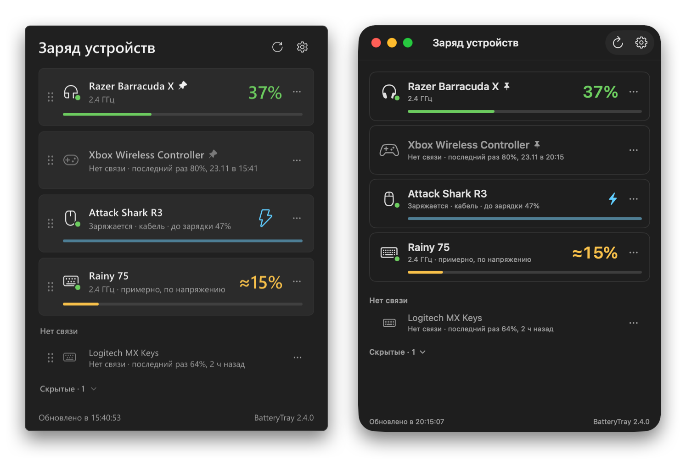
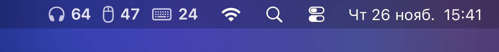
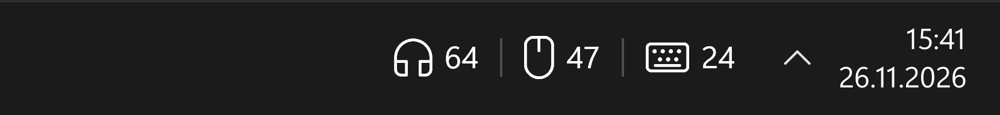
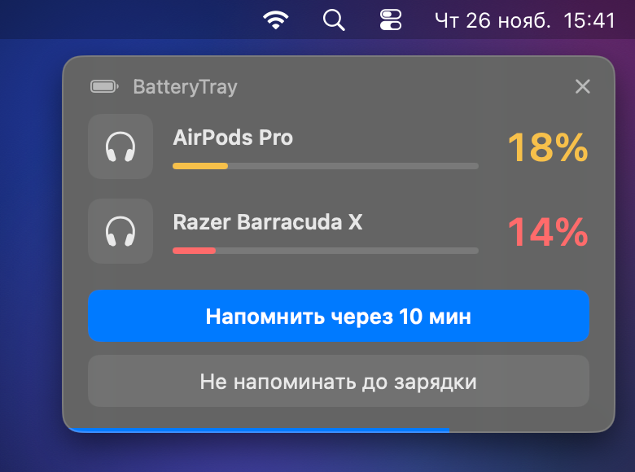
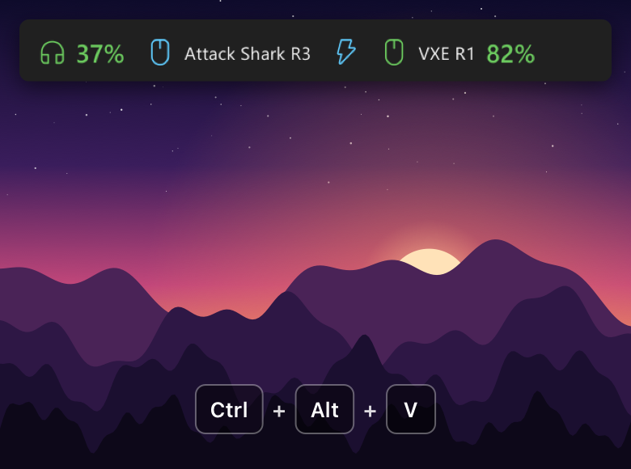
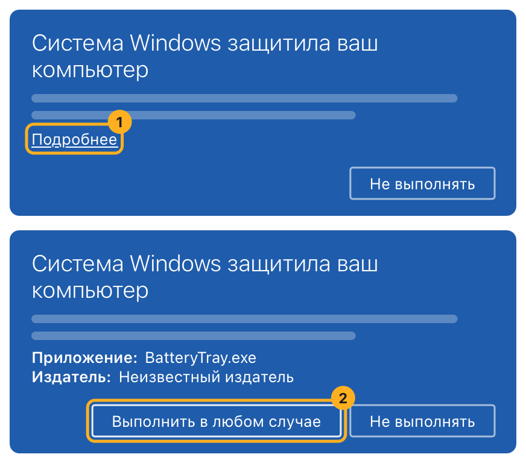
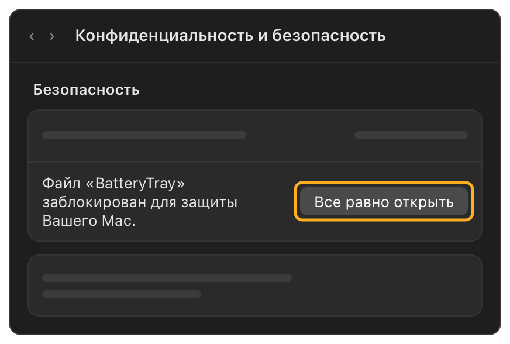

# BatteryTray

**Заряд беспроводных наушников, мыши, клавиатуры и геймпада — на панели задач Windows и в строке меню Mac.**

[English](README.md) · **Русский** · [中文](README.zh-CN.md)

&nbsp;&nbsp;

Бесплатно и с открытым кодом · без аккаунта и фирменного софта · <a href="#установка">как установить</a> · <a href="https://github.com/qu1ncky/BatteryTray/releases">что нового</a>

- **Одна программа для всех устройств.** Игровые мыши, клавиатуры и гарнитуры Razer, Logitech, SteelSeries, HyperX, Corsair, ASUS ROG и десятков других брендов — через их приёмники 2,4 ГГц, а ещё AirPods, геймпады Xbox и DualSense и любые Bluetooth-устройства, заряд которых знает система. [Поддерживаемые устройства](docs/ru/devices.md)
- **Всегда на виду.** У часов в Windows и в строке меню на Mac; садящееся устройство выделено тревожным цветом.
- **Напоминание, которое не пропустишь** — до того, как батарея сядет посреди игры или созвона. Режим «Не беспокоить» его не прячет.
- **Поверх игр:** включите оверлей в «Настройки → Оверлей», и <kbd>Ctrl</kbd>+<kbd>Alt</kbd>+<kbd>V</kbd> (<kbd>⌃⌥V</kbd> на Mac) на пять секунд покажет заряд всех устройств. [Все возможности](docs/ru/features.md)

   
  Строка меню Mac

   
  Панель задач Windows (Настройки → Общие → Панель задач)

<table>
<tr>
<td width="50%"></td>
<td width="50%"></td>
</tr>
<tr>
<td align="center">Напоминание: отложить, не напоминать до зарядки или дать ему закрыться самому</td>
<td align="center">Оверлей — поверх игр и полноэкранных приложений</td>
</tr>
</table>

## Установка

<table>
<tr>
<td width="50%" valign="top">

**Windows 10 и 11**

1. Скачайте [`BatteryTray.exe`](https://github.com/qu1ncky/BatteryTray/releases/latest/download/BatteryTray.exe) и запустите.
2. Если Windows предупредит о неизвестном приложении: **Подробнее** → **Выполнить в любом случае**.
3. Заряд появится у часов (Windows 11 может спрятать его под **^** — перетащите на панель задач). Кнопка **«Включить»** над списком устройств добавит программу в автозапуск.

Или `winget install qu1ncky.BatteryTray`, или [Scoop](https://scoop.sh): `scoop bucket add batterytray https://github.com/qu1ncky/BatteryTray`, затем `scoop install batterytray`.

</td>
<td width="50%" valign="top">

**macOS 13 и новее**, Apple Silicon и Intel

1. Откройте [`BatteryTray-macOS.dmg`](https://github.com/qu1ncky/BatteryTray/releases/latest/download/BatteryTray-macOS.dmg) и перетащите **BatteryTray** в **«Программы»**.
2. Запустите. В первый раз macOS его заблокирует: **Системные настройки → Конфиденциальность и безопасность → Все равно открыть**.
3. Разрешите Bluetooth — заряд появится в строке меню. Кнопка **«Включить»** над списком устройств включит открытие при входе в систему.

Разрешения: Bluetooth и «Мониторинг ввода» — только если подключена клавиатура (macOS требует его от любой программы, которая её открывает; BatteryTray читает только заряд). Больше ничего.

</td>
</tr>
</table>

## Подробнее

[Поддерживаемые устройства](docs/ru/devices.md) · [Все возможности](docs/ru/features.md) · [Частые вопросы](docs/ru/faq.md) · [Как это работает](docs/ru/how-it-works.md) · [Сборка из исходников](docs/development.md) · [Что нового](https://github.com/qu1ncky/BatteryTray/releases)

Нет вашего устройства или что-то не так? [Создайте issue](https://github.com/qu1ncky/BatteryTray/issues) и приложите лог: `%LOCALAPPDATA%\BatteryTray\log.txt` в Windows, `~/Library/Application Support/BatteryTray/log.txt` на Mac. Чтобы добавили новое устройство, приложите ещё вывод [этой команды](docs/ru/devices.md#устройства-нет-в-списке), пока оно подключено: она покажет USB ID его приёмника.

## Лицензия

[MIT](LICENSE). Сторонний код, источники протоколов и атрибуция Slint — в [THIRD_PARTY_NOTICES.md](THIRD_PARTY_NOTICES.md). Проект не связан с Apple, Razer, Logitech, SteelSeries, HyperX, Corsair, ASUS, Sony, Microsoft, Valve, ATTACK SHARK и другими упомянутыми производителями; названия продуктов — товарные знаки их владельцев.
