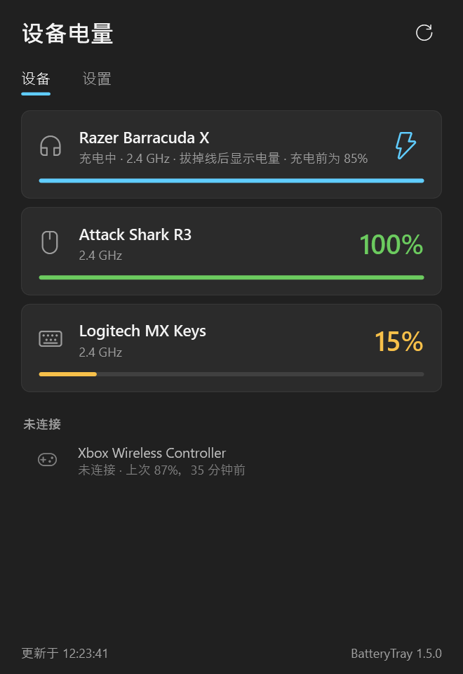

# BatteryTray — 在 Windows 托盘显示无线耳机、鼠标、键盘和手柄的电量

[English](README.md) · [Русский](README.ru.md) · **中文**

在任务栏时钟旁边查看无线耳机、鼠标、键盘和手柄还剩多少电量，并在它们没电**之前**提醒你。一个小程序管理所有设备，无需 Razer Synapse、Logitech G HUB、SteelSeries GG 等厂商软件，无需账号，只读取电量。

## 功能

- **托盘电量图标**：显示最先没电的设备；绿色正常，低于提醒值为黄色，低于严重值为红色，充电时为蓝色。鼠标悬停可查看全部设备。
- **一个窗口查看所有设备**：已连接的设备显示电量，未连接的显示上次电量和时间。
- **不会错过的低电量提醒**：屏幕角落的置顶小窗口，不受“勿扰模式”影响，不会自动消失，也不会抢走游戏焦点。
- **充电完成通知**：支持报告充电完成的设备在充满时发出 Windows 通知。
- **不显示虚构的电量**：设备充电时无法报告电量时，显示充电状态而不是过时的数字；估算值以“≈”标记。
- **中文、英文、俄文界面**：跟随 Windows 语言，也可以在“设置”中随时切换，无需重启。
- **自动更新**：从 GitHub 发布页下载并校验 SHA-256，在窗口关闭时静默安装。

## 支持的设备

Razer Barracuda X（2.4 GHz 接收器，已测试）、Attack Shark R3 及其他 Rongyuan 平台鼠标键盘、约 40 款 Razer 无线鼠标和 HyperSpeed 键盘、Logitech HID++ 设备（MX Master、MX Keys、G Lightspeed 系列等）、Logitech G / SteelSeries Arctis / HyperX Cloud / Corsair Void 等约 70 款无线耳机、SteelSeries 无线鼠标、Sony DualSense / DualShock 4、Xbox 手柄，以及 Windows 能显示电量的任何蓝牙设备。完整列表见 [英文说明](README.md#supported-devices)。

标记为“未测试”的设备是按照公开的开源协议实现的，尚未在真机上验证；如果你有这些设备，欢迎在 [Issues](https://github.com/qu1ncky/BatteryTray/issues) 反馈。

## 下载和安装

1. 从 [Releases](https://github.com/qu1ncky/BatteryTray/releases/latest) 下载 `BatteryTray-…-win-x64.zip` 并解压。
2. 运行 `install.cmd`，确认管理员权限提示。
3. 图标会出现在时钟旁边。Windows 11 会把新图标收进 **^** 箭头里，可以把它拖到任务栏上常驻显示。

程序安装到 `C:\Program Files\BatteryTray`，通过名为“BatteryTray”的计划任务在登录时启动，无需安装 .NET。卸载请运行压缩包中的 `uninstall.cmd`。程序未进行代码签名，Windows 可能会提示未知应用：点击“更多信息”→“仍要运行”。

## 许可证

MIT，见 [LICENSE](LICENSE)。本项目与 Razer、Logitech、SteelSeries、HyperX、Corsair、Sony、Microsoft 及 ATTACK SHARK 无关；产品名称为其各自所有者的商标。
