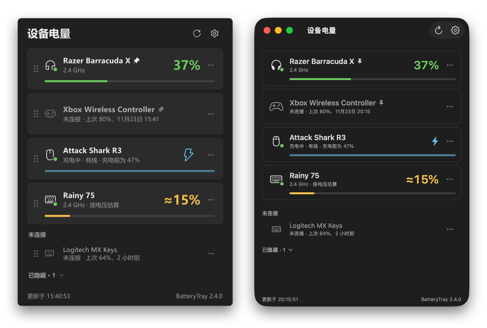
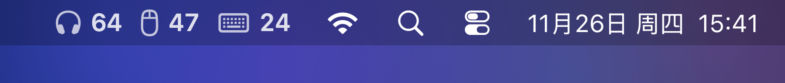
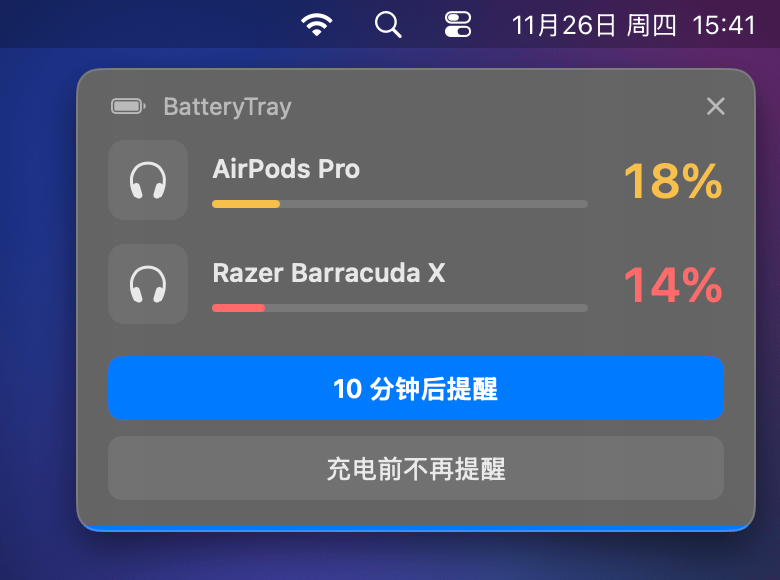
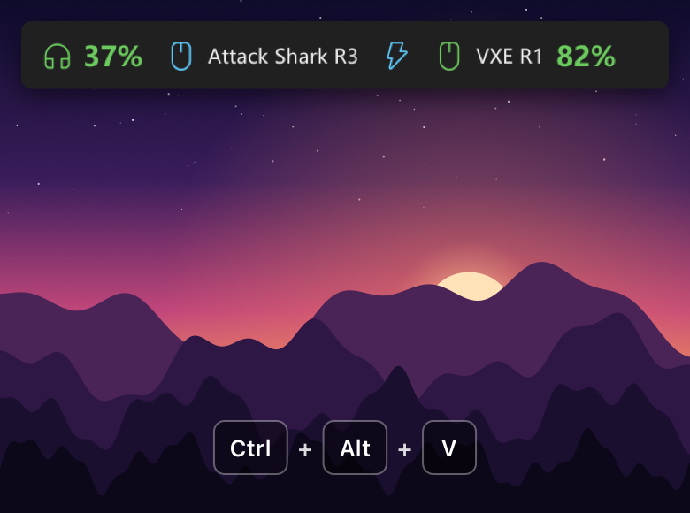
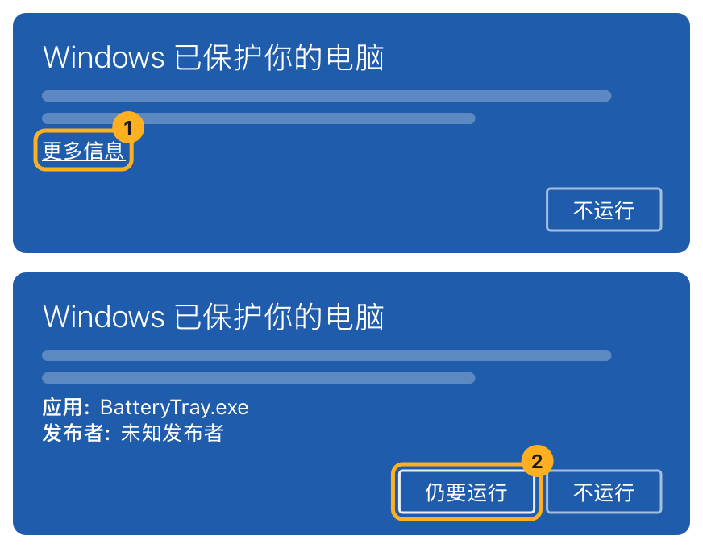
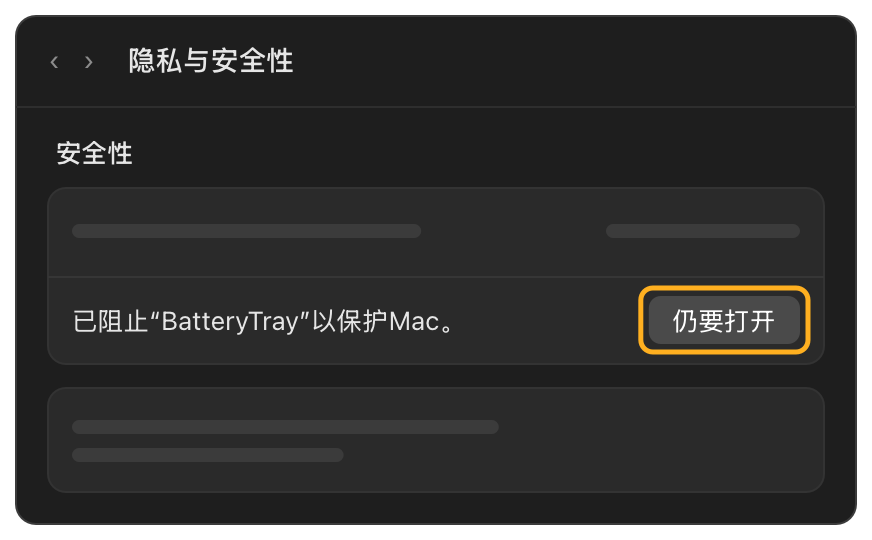

# BatteryTray

**无线耳机、鼠标、键盘和手柄的电量—— 显示在 Windows 任务栏和 Mac 菜单栏中。**

[English](README.md) · [Русский](README.ru.md) · **中文**

&nbsp;&nbsp;

免费开源 · 无需账号和厂商软件 · <a href="#下载和安装">如何安装</a> · <a href="https://github.com/qu1ncky/BatteryTray/releases">更新说明</a>

- **一个程序管理所有设备。** 通过 2.4 GHz 接收器读取 Razer、Logitech、SteelSeries、HyperX、Corsair、ASUS ROG 等数十个品牌的游戏鼠标、键盘和耳机，还支持 Xbox 和 DualSense 手柄、AirPods，以及系统能读到电量的任何蓝牙设备。[支持的设备](docs/zh/devices.md)
- **始终可见。** 显示在 Windows 时钟旁和 Mac 菜单栏中；设备电量不足时会用警示色显示。
- **不会错过的提醒**：在游戏或通话中途没电之前提醒你。勿扰模式不会隐藏它。
- **游戏中也能看：** 在“设置 → 悬浮窗”中启用后，按 <kbd>Ctrl</kbd>+<kbd>Alt</kbd>+<kbd>V</kbd>（Mac 上为 <kbd>⌃⌥V</kbd>），所有设备的电量会显示五秒。[全部功能](docs/zh/features.md)

   
  Mac 菜单栏

   
  Windows 任务栏（设置 → 常规 → 任务栏）

<table>
<tr>
<td width="50%"></td>
<td width="50%"></td>
</tr>
<tr>
<td align="center">提醒：稍后提醒、充电前不再提醒，或让它自动关闭</td>
<td align="center">悬浮窗：显示在游戏和全屏应用之上</td>
</tr>
</table>

## 下载和安装

<table>
<tr>
<td width="50%" valign="top">

**Windows 10 和 11**

1. 下载 [`BatteryTray.exe`](https://github.com/qu1ncky/BatteryTray/releases/latest/download/BatteryTray.exe) 并运行。
2. 如果 Windows 提示未知应用：点击 **更多信息** → **仍要运行**。
3. 电量会显示在时钟旁（Windows 11 可能把它收进 **^** 里，把它拖到任务栏上即可）。点击设备列表上方的 **启用**，即可开机自动启动。

也可以用 `winget install qu1ncky.BatteryTray`，或 [Scoop](https://scoop.sh)：`scoop bucket add batterytray https://github.com/qu1ncky/BatteryTray`，然后 `scoop install batterytray`。

</td>
<td width="50%" valign="top">

**macOS 13 或更高版本**，Apple 芯片和 Intel

1. 打开 [`BatteryTray-macOS.dmg`](https://github.com/qu1ncky/BatteryTray/releases/latest/download/BatteryTray-macOS.dmg)，把 **BatteryTray** 拖到 **应用程序**。
2. 打开它。第一次打开时 macOS 会阻止：前往 **系统设置 → 隐私与安全性 → 仍要打开**。
3. 允许蓝牙访问，电量就会显示在菜单栏中。点击设备列表上方的 **启用**，即可登录时打开。

权限：蓝牙；只有连接键盘时才需要“输入监控”（macOS 要求所有打开键盘的应用都具备此权限；BatteryTray 只读取电量）。不需要其他权限。

</td>
</tr>
</table>

## 更多

[支持的设备](docs/zh/devices.md) · [全部功能](docs/zh/features.md) · [常见问题](docs/zh/faq.md) · [工作原理](docs/zh/how-it-works.md) · [从源码构建](docs/development.md) · [更新说明](https://github.com/qu1ncky/BatteryTray/releases)

没有找到你的设备，或遇到问题？请[提交 issue](https://github.com/qu1ncky/BatteryTray/issues) 并附上日志：Windows 上为 `%LOCALAPPDATA%\BatteryTray\log.txt`，Mac 上为 `~/Library/Application Support/BatteryTray/log.txt`。如需添加新设备，还请在设备连接时附上[这条命令](docs/zh/devices.md#设备不在列表中)的输出，它会显示设备接收器的 USB ID。

## 许可证

[MIT](LICENSE)。第三方代码、协议来源和 Slint 署名见 [THIRD_PARTY_NOTICES.md](THIRD_PARTY_NOTICES.md)。本项目与 Apple、Razer、Logitech、SteelSeries、HyperX、Corsair、ASUS、Sony、Microsoft、Valve、ATTACK SHARK 及文中提到的其他厂商无关；产品名称是其各自所有者的商标。
